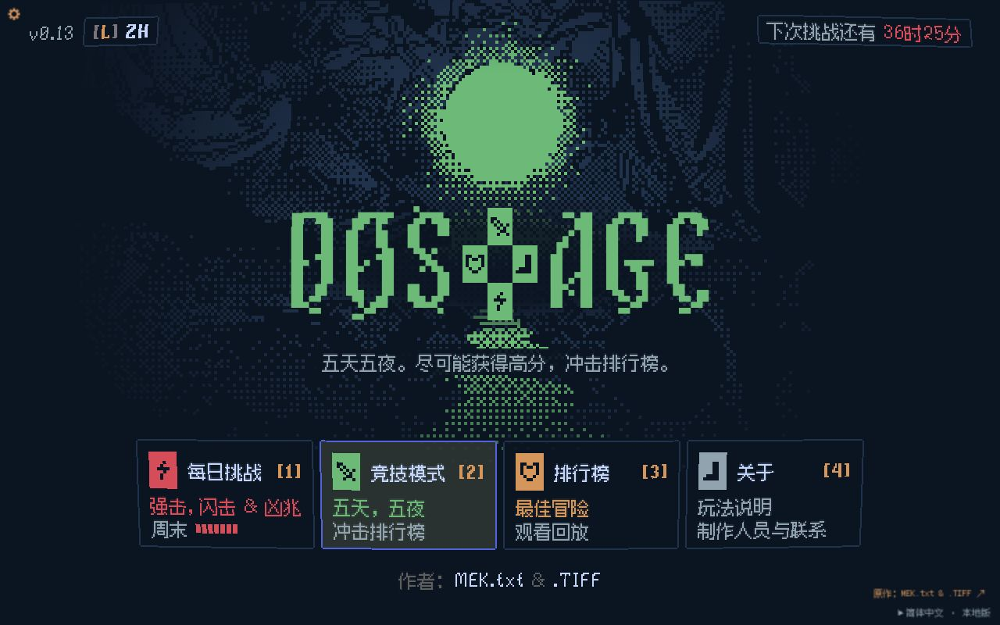

# DOS-AGE 简体中文版

DOS-AGE v0.13 的非官方简体中文汉化，保留原作的像素风格、回合制探索、职业和战斗规则。

- **在线游玩：https://dosage.bitfroth.com/**
- **代码仓库：https://github.com/miaoz/dos-age-zh**
- 原作：https://dos-age.com/ （MEK.txt 与 .TIFF）



## 汉化内容

- 1,167 条界面与叙事文本，870 个名词及变体。
- 主菜单、职业、装备、技能、对话、战斗日志、帮助与设置。
- 默认简体中文，可在设置中切换英语。
- Fusion Pixel Font 12px 简体中文等宽像素字体，随项目内置，无需在线字体服务。
- 中文点阵缓存、最近邻放大及自动换行。当前语言包中的 1,240 个汉字及相关字符均有对应字形。
- 桌面与触屏布局，中文玩法说明页面。

## 游玩范围

游戏可以直接通过网站运行，也可以在本机启动。此独立版本未连接原站后端，因此全球排行榜、联网聊天、其他玩家回放以及服务器提供的亡魂和宿敌数据不可用。相关接口返回明确的离线状态。聊天输入中的 `/help` 仍可本地使用。

原版动画图片中内嵌的英文（如 dodge）及 DOS-AGE 字标保留原图。游戏内容使用 2026-10-31 获取的原站 v0.13 资源；未穷尽验证每一种随机事件。

## 本地启动

需要 Node.js 22 或更高版本。本地游玩不需要安装 npm 依赖。

```sh
git clone https://github.com/miaoz/dos-age-zh.git
cd dos-age-zh
npm start
```

打开 http://127.0.0.1:4173/ 。macOS 可双击 `start.command`。按 Ctrl+C 停止服务；需要其他端口时运行 `PORT=4174 npm start`。

请使用 HTTP 服务，不要直接通过 `file://` 打开 HTML，因为浏览器需要加载 ES Modules 和语言 JSON。

## 维护与检查

```sh
python3 tools/build-language.py
python3 tools/apply-localization.py
npm run check
```

- `dist/lang/zh-CN.json`：生成后的中文语言包。
- `tools/strings-{a,b,c}.json`：分段翻译源文件。
- `tools/nouns-base.tsv`：统一术语和名词基础翻译。
- `tools/build-language.py`：合并翻译并生成名词变体。
- `tools/apply-localization.py`：基于 `tools/original/` 中的备份重建汉化模块。
- `dist/zh-font.js`、`dist/web/zh-font.css`：中文像素字体渲染与加载。
- `tools/check.mjs`：语言包覆盖度、变量、颜色标签、中文换行、语法、模块依赖和离线接口检查。

GitHub Actions 在 push / pull request 时执行检查。对翻译源的修改应运行上述生成命令并提交生成结果。`tools/fetch-original.py` 是最初下载资源的辅助脚本，不能当作无条件更新工具；升级原版需要重新匹配资源和语言模板。

## Cloudflare Pages 部署

项目名为 `dos-age-zh`，生产分支为 `main`，仅上传 `dist/`。自定义域名 `dosage.bitfroth.com` 指向 `dos-age-zh.pages.dev`。

```sh
npm ci
cp .env.example .env
# 在 .env 中填写 CLOUDFLARE_ACCOUNT_ID 和 CLOUDFLARE_API_TOKEN
npm run deploy
```

部署工具先运行检查，再使用固定版本的 Wrangler 上传静态资源。`.env` 仅用于本机认证，不会上传至 Pages，也不应提交到仓库。CI 仅做检查，推送代码不会自动部署；发布由 `npm run deploy` 执行。

- `wrangler.toml`：Pages 项目与静态目录配置。
- `dist/_worker.js`：对未接入的 `/scores` 和 `/chat` 接口返回 JSON 503。
- `dist/_routes.json`：仅上述接口运行 Function，游戏资源由 Pages 静态托管。
- `dist/404.html`：避免不存在的资源错误返回游戏首页。
- `dist/_headers`：资源缓存与响应头。

## 原作与许可

原作作者为 [MEK.txt](https://mektxt.com/) 与 [.TIFF](https://x.com/alexandratiff)。这是非官方汉化仓库，不代表原作者。原作代码、美术、字体、音效和音乐的权利归原作者及相应权利人所有，本仓库不为原作资源授予新的开源许可。

中文字体 Fusion Pixel Font 采用 SIL Open Font License 1.1，原始字体与上游许可均随附。详见 [THIRD_PARTY_NOTICES.md](THIRD_PARTY_NOTICES.md)。
